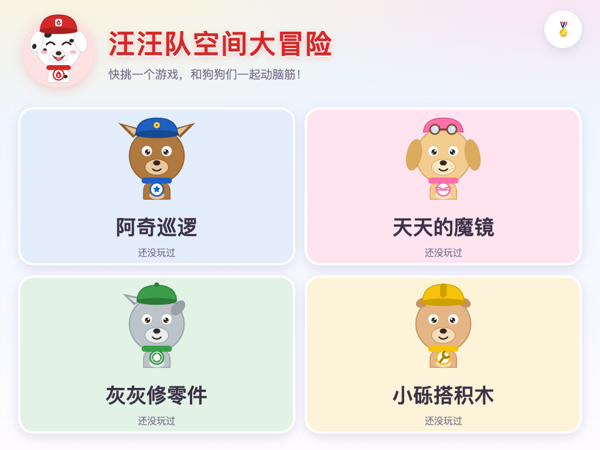
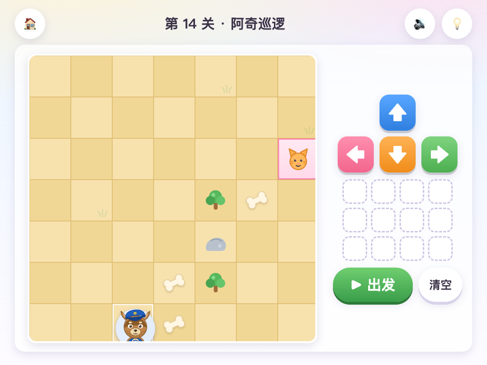
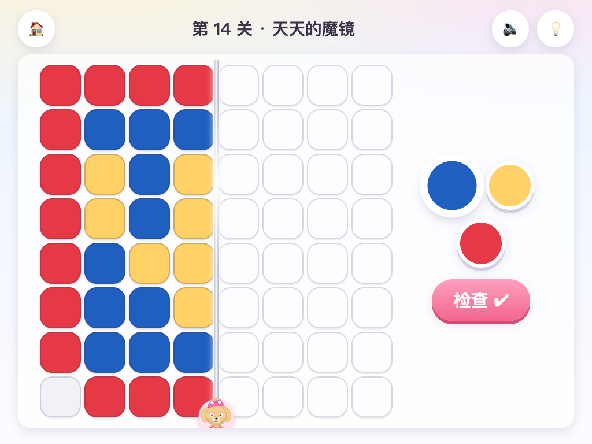
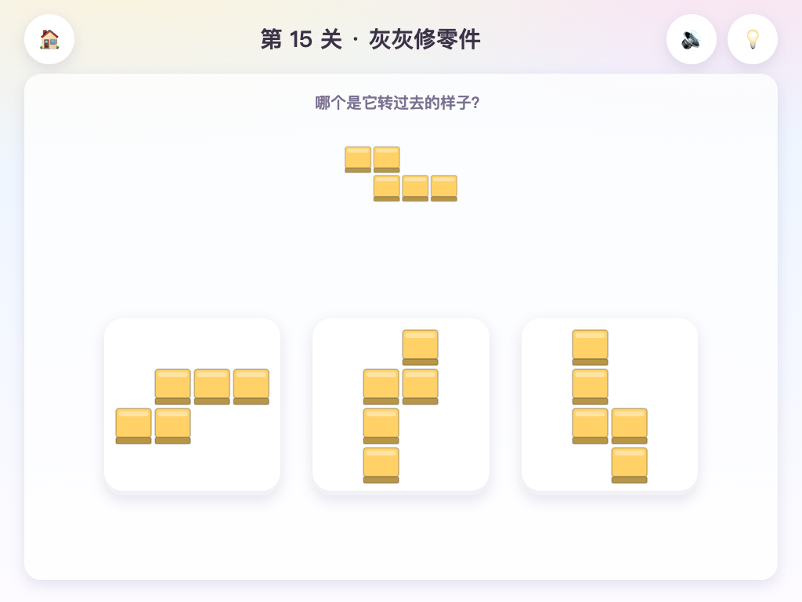
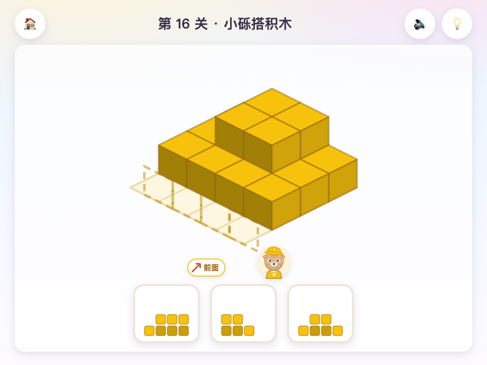

# 汪汪队空间大冒险

给一年级小朋友（6–7 岁）玩的**空间思维**益智小游戏。四只小狗各主持一个游戏，全程有狗狗语音带着玩，不认字也能玩。

**▶ 在线试玩：<https://lostxiaoq.github.io/paw-puzzle/>**（平板横屏效果最好）



## 四个小游戏

| 游戏 | 关卡 | 练什么 | 怎么玩 |
|---|---|---|---|
| 🚓 阿奇巡逻 | 14 | 方位、路线规划、编程启蒙 | 把方向卡排成一串指令，帮阿奇吃掉骨头、找到小猫 |
| 🪞 天天的魔镜 | 14 | 对称 | 魔镜坏了一半，把另一边涂成一模一样 |
| 🔧 灰灰修零件 | 15 | 心理旋转 | 把零件转到和影子一样；找出哪个是转过去的样子（不是翻面的） |
| 🧱 小砾搭积木 | 16 | 立体想象、三视图 | 数一数一共几块积木（别忘了被挡住的）；从前面看是什么样子 |

另外还有过关星星、集齐六只狗狗的徽章墙，以及连续玩 20 分钟弹出的护眼提醒。进度保存在浏览器本地。

| | |
|---|---|
|  |  |
|  |  |

## 怎么运行

直接打开上面的在线试玩链接即可。想离线玩或改代码，就在本地运行：纯静态网页，零依赖、不用构建，需要用一个本地 HTTP 服务打开（ES modules 不支持 `file://`）：

```bash
python3 -m http.server 8765
```

然后浏览器打开 <http://localhost:8765>。想在平板上玩，让平板和电脑连同一个 Wi-Fi，用 Safari 打开 `http://<电脑的局域网 IP>:8765`。

> iPad / iPhone 的浏览器要先点一下屏幕才允许出声，这是系统限制。

## 设计原则

- **不依赖阅读**：每个画面进入时由主持狗狗读出指令，右上角 🔊 可以重听。
- **只鼓励不惩罚**：做错只是轻轻抖动 + 温柔提示，连错两次 💡 提示按钮会闪烁。
- **大按钮**：所有可点元素不小于 60×60 像素，横屏平板优先，手机竖屏也能用。
- **全部现画**：狗狗、积木、地图等图形都是代码画的 SVG，音效用 WebAudio 合成。

## 配音

101 句台词由六只狗狗各自的原创童声朗读，用开源的 [Qwen3-TTS](https://github.com/QwenLM/Qwen3-TTS) 在本地生成：先用 VoiceDesign 模型按文字描述设计每只狗狗的声音，再用 Base 模型以选定的声音为参考克隆出全部台词；每句都经过语音识别转写比对质检。音频在 `audio/voice/`，清单见 [audio/voice/README.md](audio/voice/README.md)。找不到音频时自动退回浏览器自带的语音合成。

## 项目结构

```
index.html / styles/          页面与样式
src/main.js                   路由、首页、选关、游戏外框
src/core/                     路由、存档、星级、语音、音效
src/art/pups.js               六只狗狗的 SVG
src/games/<游戏>/             logic.js（纯逻辑）· levels.js（关卡）· view.js（界面）
src/voice/lines.js            全部台词（谁说、说什么）
audio/voice/                  配音 mp3 + manifest.json
docs/SPEC.md                  需求规格与接口契约
tests/accept/                 验收测试（node:test 单元测试 + Playwright 浏览器测试）
tests/unit/                   单元测试与关卡检查
```

运行逻辑测试：

```bash
node --test "tests/accept/*.test.mjs"
```

浏览器测试（`tests/accept/smoke.mjs`）依赖 `playwright-core` 和本机 Chromium，路径通过环境变量 `FORGE_PW_MODULE` / `FORGE_CHROMIUM` 指定。

## 怎么做出来的

这是一次「AI 分工」的实验：Claude 负责写需求、验收测试和任务卡，并审查每次提交的代码和截图；[Hermes Agent](https://github.com/NousResearch/hermes-agent)（驱动模型为智谱 GLM）负责具体编码。每张任务卡由调度器派发给 Hermes，完成后调度器自己重跑验收，没通过就把报错喂回去继续改，通过后才合并。

## 许可证

本项目自己创作的代码、图形和配音以 [MIT 许可证](LICENSE) 发布。这不包括「汪汪队」及其角色名称等第三方商标，它们不属于本项目，也无法由本项目授权。

## 声明

这是一个**非商业的个人作品**，最初是给自家孩子做的。游戏里出现的「汪汪队」及阿奇、毛毛、天天、小砾、灰灰、路马等角色名称归其各自权利人（Spin Master Ltd. 等）所有；本项目与权利人没有任何关联，也未获得其授权或认可。狗狗形象均为原创绘制，配音为 AI 生成的原创声音，没有模仿任何配音演员。如权利人认为不妥，请提 issue 联系，我会及时修改或下架。
